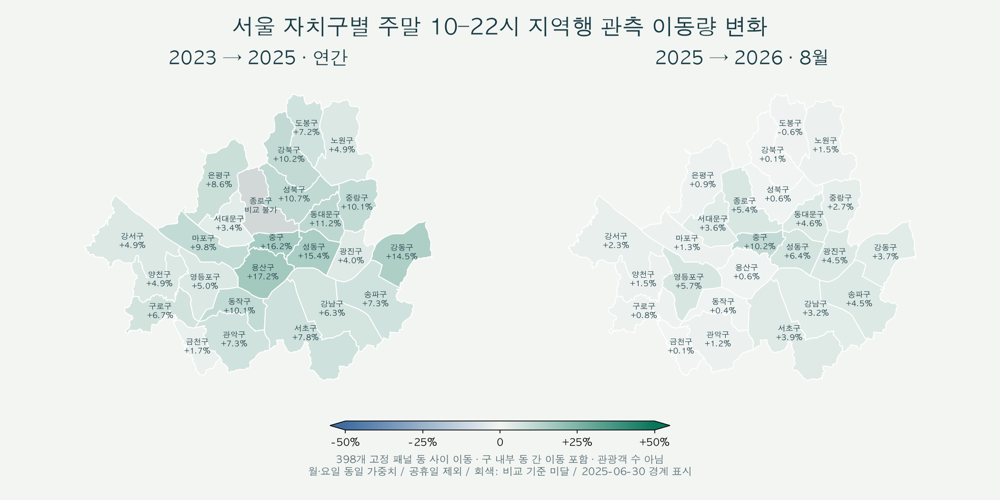

# B3-1 시계열 분석 제출물

서울시 대중교통 행정동 OD를 사용해 지역·요일·시간대별 이동 변화를 분석했다. 관광객 수나 인기의 원인을 확정하는 분석은 아니다.

- **최종 리포트:** [REPORT.md](REPORT.md) — 질문 3개, 분석 기법 4가지, 그래프 4개, 인사이트 4개, 결론·한계.
- **Python 코드:** `run_od_analysis.py`, `od_analysis/`, `scripts/acquire_transit_hourly_od.py`.
- **제공 데이터:** `data/tables/`의 소형 가공표, `data/sources/`의 출처·수집 정보, `data/evidence/`의 리포트 근거.
- **시각화:** 리포트용 PNG 4개와 지도 미리보기 PNG 1개.
- **연도·월별 지도:** [MAP.html](MAP.html)을 다운로드해 브라우저로 열면 연도·월·시간 구간·유입/유출을 바꿔 서울 25개 자치구의 변화를 볼 수 있다. GitHub 파일 화면에서는 HTML을 실행하지 않는다.

```text
B3-1/
├── REPORT.md
├── MAP.html                  연도·월·시간대별 대화형 지도 (인터넷 없이 실행)
├── figures/                  리포트 그래프 4개·지도 미리보기 1개
├── run_od_analysis.py        실행 진입점
├── od_analysis/              정제·분석·시각화·검산 코드
├── scripts/                  OD 원본 수집 코드
├── data/
│   ├── tables/               소형 가공표·지도 월별 지표
│   ├── sources/              원본 출처·수집 정보·지도 경계
│   └── evidence/             리포트·지도 근거와 검산 결과
├── requirements-od.txt
└── README.md                 실행·수집 방법
```

## 실행

Python 3.13을 사용한다. 그래프 재생성에는 AppleGothic, NanumGothic, Malgun Gothic 중 한국어 폰트 하나가 필요하다. 제공된 PNG는 별도 폰트 없이 볼 수 있다.

저장소의 `B3-1` 폴더에서 실행한다. 환경·캐시·원본은 제출 폴더 밖의 `../tmp/B3-1-work/`에 둔다.

```bash
python3 -m venv ../tmp/B3-1-work/.venv
../tmp/B3-1-work/.venv/bin/python -m pip install -r requirements-od.txt
# 제공된 소형 표로 리포트와 그래프 재생성: 원본 다운로드 불필요
../tmp/B3-1-work/.venv/bin/python -B run_od_analysis.py --from-tables
```

이 명령은 그림·리포트 재현이며 원본 재검증은 아니다. 원본을 확보한 뒤 전체 분석을 실행하려면:

```bash
../tmp/B3-1-work/.venv/bin/python -B scripts/acquire_transit_hourly_od.py
# 아래 참조 원본 6개도 확보한 뒤 실행
../tmp/B3-1-work/.venv/bin/python -B run_od_analysis.py
```

작업 폴더를 바꾸려면 `B3_OD_WORKDIR` 환경 변수에 절대 경로를 지정한다. `data/sources/`에 기록된 `data/raw/...`, `data/metadata/...` 경로는 이 작업 폴더 기준이다. 원본은 읽기만 하고, 중간 집계·파일별 감사 기록도 작업 폴더에 생성한다. 보고서와 소형 결과표만 제출 폴더에 갱신한다.

## 원본 확보

실제 이동량 자료는 **시간대별 대중교통 OD 한 종류**이며, 나머지는 지역과 공휴일 확인 자료다.

| 자료 | 출처·확보 방법 | 작업 폴더 내 저장 위치 |
|---|---|---|
| 시간대별 대중교통 행정동 OD | [서울시 OA-21226](https://data.seoul.go.kr/dataList/OA-21226/F/1/datasetView.do). 수집 스크립트가 [고정 목록](data/sources/inventory.json)의 66ZIP을 다운로드·검증 | `data/raw/transit_hourly_od/연도/` |
| 대중교통 행정동 마스터 | [서울시 OA-21234](https://data.seoul.go.kr/dataList/OA-21234/S/1/datasetView.do) CSV 다운로드. [요청 URL·POST 인자](data/sources/admin_master.json) | `data/raw/locations/admin/transit_admin_master_20261027.csv` |
| 월별 행정동 코드표 | [서울 생활이동](https://data.seoul.go.kr/dataVisual/seoul/capitalRegionLivingMigration.do)의 `admin_codes.zip`. [다운로드 요청·내부 파일 목록](data/sources/reference_sources.json) | `data/raw/locations/admin/admin_codes.zip` |
| 공휴일 표 | [한국천문연구원](https://astro.kasi.re.kr/kor/life/post/calendarData?search_year=2026)의 `search_year`를 2023~2026으로 변경해 HTML 응답을 UTF-8로 저장. [후속 공지와 처리 근거](data/evidence/calendar_sources.json) | `data/raw/calendar/calendar_data_연도.html` |

OD는 2023-01-01~2026-10-21 중 1,366일, 369,193,333행이다. 누락 24일은 0으로 채우지 않았다. [원본 목록·SHA-256](data/sources/catalog.json)과 대조한다. 공식 자료가 개정되어 해시가 다르면 과거 스냅샷과 동일한 결과를 재현했다고 판단하지 않는다. 원본 약 5.89GB는 Git에 넣지 않는다.

원본 열은 `기준_날짜`, `시작_행정동_ID`, `종료_행정동_ID`, `승객_수_00`~`승객_수_23`이다. 날짜는 요일·공휴일 구분, ID는 지역 연결, 시간별 수치는 이동량 집계에 모두 사용한다. 정확한 승차/하차 시간 귀속은 미확정이며 빈칸도 0으로 단정하지 않는다.

## 분석·검증

서울 398개 동 사이 이동을 고정해 비교한다. 동 내부 이동과 서울 밖 출발을 포함한 보조 범위는 주 분석에 더하지 않는다. 2023~2025 연간 비교와 2025↔2026년 1~8월 비교를 구분한다. 2026년 9~10월은 지역 코드 참조 기간 밖의 탐색값이다.

원본·가공 해시 대조, 4일의 독립 CSV 시간별 합계 검산, 누락일 유지, 그림과 문서 링크를 검사한다. [실행 검산 결과](data/evidence/final_verification.json). 전체 분석은 해시가 같은 중간 집계를 재사용할 수 있다. 구체적인 정제 기준과 관찰·가설·한계는 리포트에 있다.

## 지도 해석·재현



`MAP.html`의 색은 398개 고정 패널 동 사이 이동을 자치구별로 합산한 변화율이다. 같은 구 안의 서로 다른 동 사이 이동도 포함하므로 **구 경계를 넘은 이동만을 뜻하지 않는다.** 색은 구 전체 경계에 표시하지만 값은 분석 대상 동만 포함한다. 관광객 수나 원인의 증명이 아니다.

먼저 구·날짜별 시간당 이동량을 합산한다. 구의 패널 동 중 어느 동이든 필요한 시간값이 없으면 그 날·구간은 제외한다. 일반일의 각 요일에 같은 가중치를 적용하며 요일별 최소 2일이 있어야 월 지표를 제공한다. 연도 지표는 유효한 모든 월에 같은 가중치를 적용한다. 원본의 빈 셀은 미상으로 유지한다. 구 집계는 완전한 구·날짜를 요구하므로 기존 동별 표를 단순히 더한 값과 다를 수 있다.

2023~2025년은 1~12월, 2026년이 포함되면 양쪽 모두 1~8월 비교다. 2026년 9~10월은 지역 코드 검증 범위 밖이므로 지도에서 제외했다. 기준값 0·자료 없음·비교 기준 미달은 변화율 없이 회색으로 표시한다. 연도별 월 추세선과 기준/비교 값, 변화량, 관측일 수를 함께 확인할 수 있다.

지도 경계는 [서울시 공개 격자 선택기](https://data.seoul.go.kr/opendata/seoulStay/grid_viewer.html)의 2025-06-30 자치구 경계 추출본이며, 이동 자료를 추가로 합친 것이 아니다. 출처·해시는 `data/sources/map_boundary_source.json`에 있다. 경계 원본을 재확보할 때는 해당 페이지의 `const SIGUNGU` JSON을 추출하고 기록된 SHA-256과 대조한다.

지도만 재생성하려면 `python -B -m od_analysis.map_view --from-tables`를 실행한다. 검증된 중간 집계로 월별 지도 지표까지 다시 계산하려면 `--from-tables`를 생략한다. 두 명령 모두 위에서 설치한 가상환경의 Python을 사용한다. 원본은 수정하지 않는다. 지도 월별 표와 생성 파일의 해시는 `data/evidence/map_verification.json`에 기록한다.

예측은 포함하지 않는다. 제출자는 리포트의 질문·처리 기준·수치·해석 한계를 직접 설명할 수 있어야 한다.
