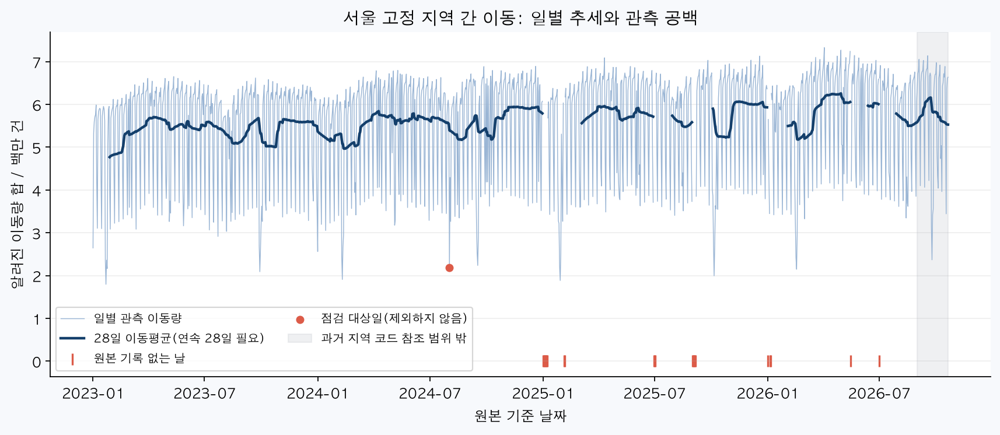
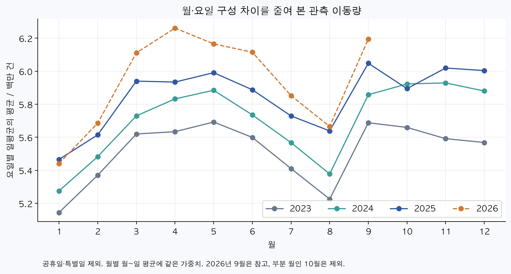
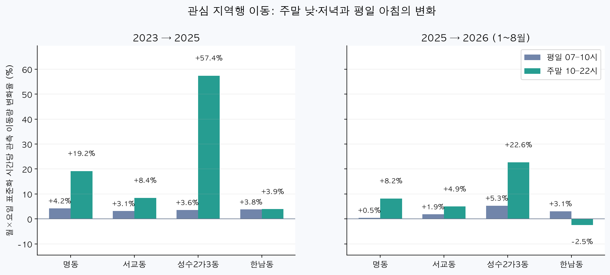
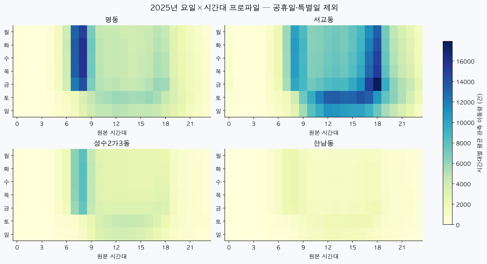

# 서울의 어느 지역으로 향하는 이동이 변했나?

**1,366개 날짜, 원본 369,193,333행을 검증해 서울 398개 동 사이의 이동을 분석했다.** 관심 지역 4곳 중 성수2가3동의 주말 10~22시 변화율은 2023→2025년 +57.4%다. 이는 관광객 증가율이 아니라 공개 OD에서 관측된 이동량 변화다.

## 1. 분석 주제와 질문

대중교통을 통해 지역에 오고 가는 시간 패턴으로 관광·여가 방문 변화의 단서를 탐색한다.

1. 2023~2025년 서울 내 이동의 장기 추세·계절·요일 패턴은 무엇인가?
2. 명동·서교동·성수2가3동·한남동에서 주말 10~22시와 평일 7~10시의 변화는 다른가?
3. 2026년 1~8월은 전년 동기간보다 달라졌나? 시간 구간·출발지 범위·이상일 처리에 따라 해석은 바뀌는가?

## 2. 데이터와 분석 범위

- [서울시 행정동 단위 대중교통 출발지/도착지 승객수 OA-21226](https://data.seoul.go.kr/dataList/OA-21226/F/1/datasetView.do): 2023-01-01~2026-10-21, 월 ZIP 45개·일 ZIP 21개. 5.89GB 원본, **369,193,333행**. [출처·수집 방법](README.md#원본-확보).
- 27열: 기준 날짜, 출발 ID, 도착 ID, 00~23시 승객 수. 버스·지하철 합산, 개별 수단 분리 불가. 단위는 관측 이동량(건), 고유 사람 수 아님.
- [공식 행정동 마스터 OA-21234](https://data.seoul.go.kr/dataList/OA-21234/S/1/datasetView.do) 2,270행과 2023-01~2026-08 월별 행정동 코드표. 코드 체계가 달라 서울 구·동 이름으로 교차 확인했다.
- 417개 동의 월별 이름·코드가 유지되지만, 고덕1동은 서로 다른 ID가 같은 OD 키에 함께 나타나 값을 합칠 근거가 불명확하다. **고덕1동 및 관측일 일부에서 기록이 없는 18개 동을 전 기간 제외한 398개 동 사이 이동**이 주 분석이다. 지역 이름의 유지와 실제 날짜별 관측 여부는 별도로 검사했다. 서울 밖 출발과 동 내부 이동을 포함한 보조 결과도 따로 제시한다.
- 현재 마스터와 동일 이름·코드가 실제 과거 경계·역 위치 불변을 보장하지 않는다. **2026년 9~10월은 코드 참조 기간 밖의 탐색값**, 정식 전년 비교는 **1~8월**이다.
- 공휴일은 보관한 [한국천문연구원 달력](https://astro.kasi.re.kr/kor/life/post/calendarData?search_year=2026)과 후속 공식 공지를 반영했다. [일자·근거](data/evidence/calendar_sources.json). 2023~2025년 5월 1일은 별도 특별일로 제외했다.

## 3. 정제·결측·이상치 기준

| 항목 | 실제 검사와 처리 |
|---|---|
| 누락 날짜 | 총 24일: 2025년 19일, 2026년 5일. [날짜 목록](data/tables/missing_dates.csv). 0으로 채우거나 보간하지 않음 |
| 원본 보존 | 66개 SHA-256 대조, ZIP 전체 읽기 CRC 확인, 모든 행 숫자·날짜 검사. 원본 수정·전체 압축 해제 사본 없음 |
| 빈 시간 셀 | 미상 유지. 알려진 숫자만 합산하며 전부 빈 지역·시간은 null. 비교 시간 구간은 모든 시간 집계가 존재할 때 사용 |
| 숫자 오류 | 비어 있지 않은 모든 시간 셀 정수 파싱 성공, 음수 행 0개 |
| 원본 키 중복 | 완전히 같은 행 2,194개 제거; 값 충돌 행 0개 제외 |
| 공식 별칭 연결 후 중복 | 같은 값 765개 제거; 다른 값 215,206개 제외. 충돌 지역은 주 패널에서 전 기간 제외 |
| 코드 미연결 | 이름을 추측하거나 ID 자릿수를 바꾸지 않음. 주 분석 제외, 감사 기록 유지 |
| 이상일 | 같은 연도·월·요일 중앙값 대비 이동량 <0.35배/>2.5배 또는 행 수 <0.5배인 일반일 1개 점검 표시. 주 결과에는 유지, 제외 결과 별도 재계산 |
| 검산 | 모든 관측일·24시간에서 주 분석 유입 합계=유출 합계. 독립 표본 검산과 테스트는 [검산 결과](data/evidence/final_verification.json) 참조 |

| 연도 | 관측일 | 빈 시간 셀 비율 | 미연결 코드 행의 관측 이동량 비율 |
|---|---|---|---|
| 2023 | 365 | 74.40% | 2.97% |
| 2024 | 366 | 74.38% | 3.09% |
| 2025 | 346 | 74.53% | 6.84% |
| 2026 | 289 | 74.47% | 7.84% |

빈 셀 비율은 24개 열 전체 기준이며, 낮은 이동이 빈 셀로 표현되는지 또는 미수집인지 공식 정의로 확정하지 못했다. 따라서 **표의 합계는 알려진 값의 합이며 완전한 전체 통행량으로 단정하지 않는다.** 미연결 비율은 코드 결측·음수·원본 키 중복 처리를 거친 행에서 계산한 미연결 이동량을 원본 전체 알려진 합으로 나눈 감사 지표다.

## 4. 시계열 분석 방법

1. **28일 이동평균:** 요일별 흔들림을 완화해 장기 흐름을 본다. 날짜 인덱스를 유지하며 연속 28일 모두 관측된 창에서만 표시한다. 자료 없는 날을 건너뛴 28행 평균이 아니다.
2. **월×요일 표준화 평균:** 일반일을 같은 월·요일별로 묶어 일평균을 구한 뒤 각 층에 동일 가중치를 준다. 주말은 월×토/일, 평일 아침은 월×월~금. 모든 층이 있고 각 층 최소 2일일 때 비교한다.
3. **변화율:** `(비교기간 표준화 평균 / 기준기간 표준화 평균 - 1) × 100`. 기준이 0이거나 비교 조건 미충족이면 제시하지 않는다. 시간 길이가 다른 구간은 시간당 건수로 환산한다.
4. **요일×시간 프로파일·민감도:** 2025 일반일 프로파일, 주말 12~20시로 축소한 결과, 이상일 제외, 서울 밖 출발 포함 결과를 함께 확인한다. 공휴일은 일반 주말에 섞지 않는다.

트렌드는 여러 달에 걸친 방향, 계절성은 월·요일·시간에 반복되는 패턴, 노이즈는 불규칙한 변동이다. 이번에 계절성을 수학적으로 분해하거나 미래를 예측한 것은 아니다.

## 5. 시각화

### ① 관측 추세와 누락

일별선과 이동평균의 차이는 단기 변동이다. 빨간 표시가 있는 날은 관측 공백이며 수요 0이 아니다. 2026년 회색 구간은 지역 코드 참조 기간 밖이다.

### ② 월별·연도별 패턴

요일 구성과 공휴일 차이를 일부 줄인 결과다. 날씨·행사·방학·자료 집계 방식 변화까지 통제하지는 않았다. 부분 월인 2026년 10월은 이 비교에서 제외했다.

### ③ 관심 지역의 시간 구간별 변화

| 지역 | 비교 | 구간 | 기준(건/시간) | 비교(건/시간) | 변화율 |
|---|---|---|---|---|---|
| 서교동 | 2023→2025 | 평일 07–10시 | 7,987.4 | 8,237.3 | +3.1% |
| 성수2가3동 | 2023→2025 | 평일 07–10시 | 6,054.1 | 6,269.6 | +3.6% |
| 한남동 | 2023→2025 | 평일 07–10시 | 2,042.0 | 2,119.1 | +3.8% |
| 명동 | 2023→2025 | 평일 07–10시 | 11,421.8 | 11,904.6 | +4.2% |
| 서교동 | 2023→2025 | 주말 10–22시 | 8,904.1 | 9,652.6 | +8.4% |
| 성수2가3동 | 2023→2025 | 주말 10–22시 | 1,752.4 | 2,758.7 | +57.4% |
| 한남동 | 2023→2025 | 주말 10–22시 | 1,302.5 | 1,353.4 | +3.9% |
| 명동 | 2023→2025 | 주말 10–22시 | 3,678.7 | 4,384.5 | +19.2% |
| 서교동 | 2024→2025 | 평일 07–10시 | 8,018.0 | 8,237.3 | +2.7% |
| 성수2가3동 | 2024→2025 | 평일 07–10시 | 6,068.5 | 6,269.6 | +3.3% |
| 한남동 | 2024→2025 | 평일 07–10시 | 2,025.4 | 2,119.1 | +4.6% |
| 명동 | 2024→2025 | 평일 07–10시 | 12,185.7 | 11,904.6 | -2.3% |
| 서교동 | 2024→2025 | 주말 10–22시 | 9,304.9 | 9,652.6 | +3.7% |
| 성수2가3동 | 2024→2025 | 주말 10–22시 | 2,201.6 | 2,758.7 | +25.3% |
| 한남동 | 2024→2025 | 주말 10–22시 | 1,322.9 | 1,353.4 | +2.3% |
| 명동 | 2024→2025 | 주말 10–22시 | 4,244.9 | 4,384.5 | +3.3% |
| 서교동 | 2025→2026 1~8월 | 평일 07–10시 | 8,160.5 | 8,312.2 | +1.9% |
| 성수2가3동 | 2025→2026 1~8월 | 평일 07–10시 | 6,230.3 | 6,561.7 | +5.3% |
| 한남동 | 2025→2026 1~8월 | 평일 07–10시 | 2,080.0 | 2,144.4 | +3.1% |
| 명동 | 2025→2026 1~8월 | 평일 07–10시 | 11,929.8 | 11,984.0 | +0.5% |
| 서교동 | 2025→2026 1~8월 | 주말 10–22시 | 9,440.9 | 9,907.5 | +4.9% |
| 성수2가3동 | 2025→2026 1~8월 | 주말 10–22시 | 2,546.1 | 3,122.7 | +22.6% |
| 한남동 | 2025→2026 1~8월 | 주말 10–22시 | 1,341.8 | 1,308.5 | -2.5% |
| 명동 | 2025→2026 1~8월 | 주말 10–22시 | 4,194.8 | 4,539.0 | +8.2% |

### ④ 요일·시간대 패턴

프로파일은 해당 지역·시간에 숫자가 있는 날의 평균이다. 시간별 분모가 다를 수 있으며 [관측일 수](data/tables/focus_2025_hour_profile_counts.csv)를 함께 제공한다.

## 6. 근거가 있는 인사이트

1. **장기 주말 변화:** 관심 지역 4곳 중 성수2가3동의 2023→2025 주말 10~22시 시간당 관측 이동량은 **1,752.4→2,758.7건(+57.4%)**이다(그림③). 같은 지역의 평일 아침 변화는 **+3.6%**다. 두 시간 구간의 차이는 방문 패턴이 다르게 변했을 가능성을 보여준다. **가설:** 여가 방문 변화와 관련될 수 있으나, 관광 목적이나 상권 매출 변화를 증명하지 않는다.
2. **2026년 동기간 변화:** 같은 4곳 중 성수2가3동의 1~8월 주말 10~22시 변화율은 **+22.6%(2,546.1→3,122.7건/시간)**다(그림③). 연간 전체와 부분 연도를 비교하지 않고 동일 월·요일 층으로 계산했다. **가설:** 최근 방문 수요 변화의 조사 후보지만 공휴일 이외의 외부 요인과 수집 변화 확인이 필요하다.
3. **시간 프로파일:** 성수2가3동의 2025년 일반 평일 평균 최댓값은 **08시**, 일반 주말은 **13시** 구간이다(그림④). 요일을 합쳐 하루 총량만 보면 이 시간 차이가 가려진다. **해석:** 출퇴근 비교군과 주말 구간을 분리해 탐색할 이유가 있다. 원본 시간의 승차/도착 귀속이 확정된 것은 아니다.

4. **전체 패널의 추세:** 월·요일을 같은 비중으로 맞춘 일평균 관측 이동량은 2023년 **5,516,931건**, 2025년 **5,847,188건(+6.0%)**이다(그림②). 관심 지역의 변화율을 전체 패널의 흐름과 구분해 볼 기준이다. 이는 공통 시간 경향을 제거한 인과 추정이나 관광 수요 증가의 증명이 아니다.

### 추가 탐색 후보: 고정 패널의 주말 변화율 상위 10곳

2023년 기준 시간당 200건 이상인 지역만 표시했다. 작은 분모로 변화율이 커지는 경우를 줄이기 위한 탐색 기준이며 통계적 유의성 판정이 아니다. 전체 서울의 관광지 순위가 아니다.

| 지역 | 2023 건/시간 | 2025 건/시간 | 변화율 |
|---|---|---|---|
| 강동구 둔촌1동 | 403.3 | 711.7 | +76.5% |
| 성동구 성수2가3동 | 1,752.4 | 2,758.7 | +57.4% |
| 관악구 중앙동 | 289.2 | 441.4 | +52.7% |
| 중랑구 상봉1동 | 217.1 | 318.4 | +46.7% |
| 관악구 신림동 | 424.1 | 605.8 | +42.9% |
| 강북구 삼양동 | 413.9 | 591.0 | +42.8% |
| 관악구 서림동 | 529.4 | 743.1 | +40.4% |
| 동작구 신대방2동 | 452.1 | 606.7 | +34.2% |
| 서초구 서초4동 | 474.8 | 634.1 | +33.5% |
| 동작구 사당1동 | 321.0 | 428.3 | +33.4% |

## 7. 민감도와 해석 한계

- 관심 4개 동 평일 아침·주말 변화율에서 점검 대상일을 제외했을 때 기준 결과와 최대 차이는 **0.29%p**였다. [전체 재계산표](data/tables/comparisons_excluding_review_days.csv). 이 값은 불확실성 신뢰구간이 아니다.
- 주말 12~20시로 줄인 결과는 [비교표의 weekend_core](data/tables/comparisons.csv)에 있다. 관심 4곳의 모든 비교에서 10~22시 결과와의 최대 차이는 **3.17%p**다. 특정 시간 선택에 민감한 지역은 강한 결론을 내리지 않는다.
- 출발지 범위를 바꾼 2023→2025 주말 변화율은 다음과 같다. 오른쪽은 주 분석, 왼쪽은 서울 밖 출발과 동 내부 이동까지 포함한 다른 범위다. 서로 더하지 않는다.

| 지역 | 비어 있지 않은 전체 출발 ID + 동 내부 포함 | 서울 고정 패널 동 간 이동 |
|---|---|---|
| 서교동 | +11.3% | +8.4% |
| 성수2가3동 | +57.6% | +57.4% |
| 한남동 | +3.7% | +3.9% |
| 명동 | +19.6% | +19.2% |

- 행정동별 총 이동량은 관광객·고유 방문자·체류시간·재방문·매출이 아니다. 주말에도 출근·귀가·생활 이동이 섞인다.
- 관측 공백으로 제외한 지역에는 새로 개발되거나 교통망이 변한 지역이 포함될 수 있다. 고정 패널은 비교 안정성을 높이지만 새 지역의 성장을 놓칠 수 있다. [제외 지역](data/evidence/presence_panel_exclusions.json).
- 주 분석은 서울의 비교 가능 지역 사이 이동에 한정된다. 수도권/전국에서 들어오는 관광 수요 전체로 일반화하지 않는다.
- 2025년 19일·2026년 5일의 누락은 무작위라는 보장이 없다. 월·요일 가중치를 맞춰도 그 날의 행사를 복원하지 못한다.
- 비교 가능한 이름·코드가 경계·역 위치·공식 집계 기준의 완전한 불변을 뜻하지 않는다. 지도상의 정밀 범위·교통 접근성의 인과 효과는 주장하지 않는다.
- 빈 시간 셀, 미연결 코드, 공개 자료 제공 범위 변화는 비교의 추가 불확실성이다. 현재 원본 시간대는 승차 기준인지 하차 기준인지 확정하지 않았다.

## 8. 결론·다음 조사

**이 결과로 지역·요일·시간대별로 관측 이동이 달라진 후보를 찾을 수 있다. 관광객 증감이나 인기의 원인은 확정할 수 없다.** 관심 지역의 결과를 행사·날씨·개통·배차·현장 방문 기록과 대조하는 것이 다음 조사다. 접근성 영향 분석에는 노선·운행 변화 자료가 추가로 필요하다.

## 9. 재현과 AI 활용 검증

[실행 방법·출처](README.md), [실제 검산 결과](data/evidence/final_verification.json).

AI는 정제·집계·시각화 코드와 해석 초안 작성에 사용했다. 실제 원본 전수 파싱, 지역 코드 감사, 유입/유출 보존 검사, 독립 CSV 표본 계산 및 경계 사례 테스트로 결과를 대조했다. “왜 늘었나”는 인과 검증을 수행하지 않았으므로 가설로만 작성했다. 최종 제출자는 위 수치·처리 기준과 한계를 설명할 수 있어야 한다.
