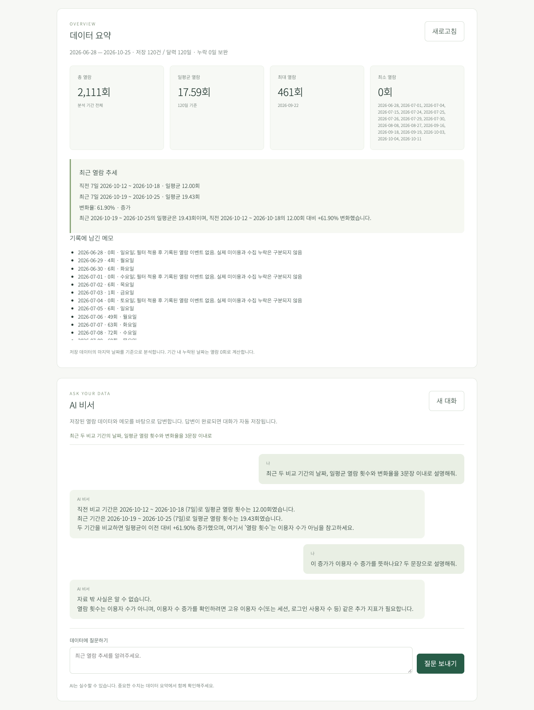
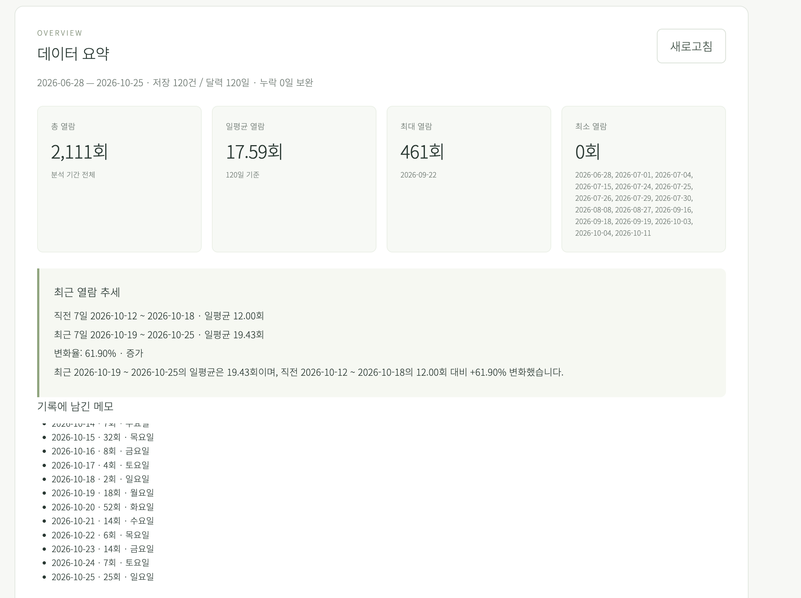
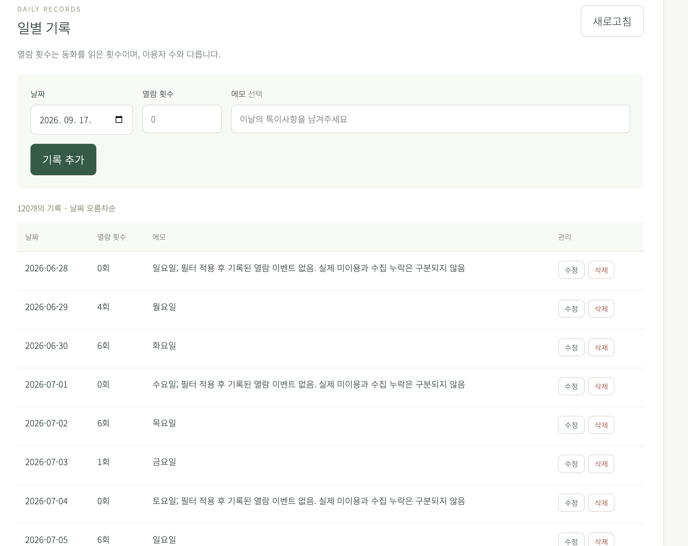
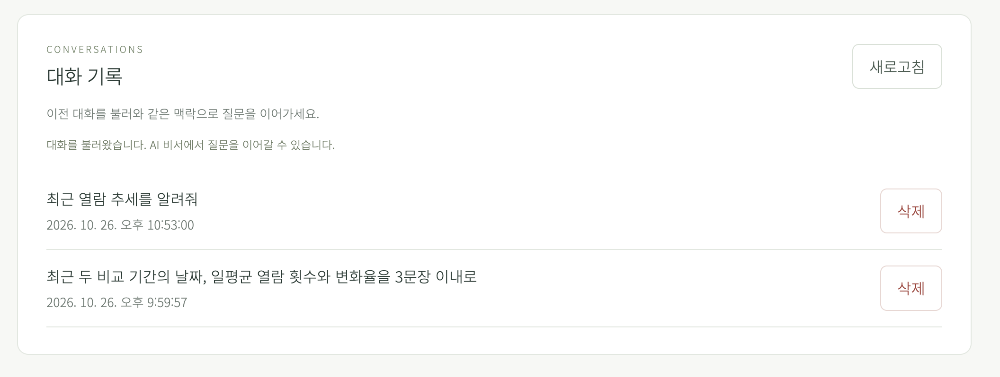

# 동화 열람 데이터 AI 비서

## 서비스 소개

동화 서비스의 일별 열람 기록을 관리하고, “최근 열람이 늘었나요?”, “어느 날 가장 많이 읽었나요?” 같은 질문에 실제 데이터로 답하는 AI 비서입니다. 흩어진 날짜별 숫자를 직접 계산하지 않아도 기간별 통계와 최근 추세를 확인할 수 있습니다.

- `date`, `value`, `memo` 형식의 일별 기록을 추가·조회·수정·삭제합니다.
- 120일치 열람 데이터를 바탕으로 합계·일평균·최대·최소·최근 추세를 요약합니다.
- 최신 요약과 이전 대화를 GPT에 전달하고 질문·답변을 자동 저장합니다.
- 저장된 대화를 다시 불러와 질문을 이어갈 수 있습니다.

열람 횟수는 이용자 수와 다르며, 메모만으로 변화의 원인을 단정하지 않습니다. 보너스 기능은 포함하지 않습니다.

## 기술 스택

| 구분 | 사용 기술 |
| --- | --- |
| 백엔드 | Python 3.10+, venv, FastAPI, Uvicorn, Pydantic |
| 데이터베이스 | Firebase Firestore, firebase-admin |
| AI | OpenAI Python SDK, GPT-5 mini, 학습장 Copa 게이트웨이의 Chat Completions |
| 환경 변수 | python-dotenv |
| 프론트엔드 | HTML, CSS, 바닐라 JavaScript (프레임워크 미사용) |
| 배포 | Render (백엔드), Vercel (프론트엔드), GitHub |
| 테스트 | pytest, HTTPX, Node.js 테스트 러너, Playwright |

## 배포 URL

| 대상 | 주소 |
| --- | --- |
| 프론트엔드 | [서비스 접속](https://codyssey-native-frontend.vercel.app) |
| 백엔드 API | [API 서버](https://codyssey-native.onrender.com) |
| Swagger UI | [API 문서와 실행](https://codyssey-native.onrender.com/docs) |

배포 브랜치는 `main`입니다. 구현 및 검증 내역은 [작업 보고서](docs/stages-2-4-report.md)와 [배포 체크리스트](docs/deployment-checklist.md)에 기록했습니다.

## 로컬 실행 방법

저장소 안의 `M1-2`에서 시작합니다. Python 3.10 이상과 Node.js 20 이상이 필요하며, 현재 Python 3.13으로 검증했습니다.

```sh
python3 -m venv backend/.venv
source backend/.venv/bin/activate
python -m pip install -r backend/requirements.txt -r backend/requirements-dev.txt
cp -n backend/.env.example backend/.env
cd backend
python -m uvicorn app.main:app --reload --port 8000
```

`backend/.env`에 실제 값을 입력합니다. 기존 파일은 덮어쓰지 않습니다. Swagger는 `http://localhost:8000/docs`입니다. 다른 터미널에서도 `M1-2` 디렉터리에서 시작합니다:

```sh
cd frontend
API_BASE_URL=http://localhost:8000 npm run build
python3 -m http.server 5500 --directory dist
```

`http://localhost:5500`에서 확인합니다. 정적 빌드 자체는 런타임 패키지를 요구하지 않습니다. 브라우저 테스트용 패키지는 아래 검증 단계에서 설치합니다.

## 환경 변수 목록

| 변수 | 위치와 값 |
| --- | --- |
| API_BASE_URL | Vercel 공개 빌드 설정: `https://codyssey-native.onrender.com` |
| ALLOWED_ORIGINS | 서버 허용 출처: `https://codyssey-native-frontend.vercel.app`; 로컬은 `http://localhost:5500` |
| FIREBASE_PROJECT_ID | 서버: `story-analytics-assistant` |
| GOOGLE_APPLICATION_CREDENTIALS | 서버 전용 서비스 계정 파일 절대 경로; Render `/etc/secrets/firebase-service-account.json` |
| OPENAI_API_KEY | 서버에만 학습장 virtual key 입력 |
| OPENAI_BASE_URL | `https://copa.codyssey.kr/v1` |
| OPENAI_MODEL | `gpt-5-mini` |

서비스 계정 JSON과 키를 Git·프론트·로그에 기록하지 않습니다. Render Secret File 이름과 환경 변수의 파일명이 정확히 일치해야 합니다. `.env`의 로컬 경로는 해당 컴퓨터의 실제 파일 위치를 사용합니다.

## AI 및 데이터 처리 규칙

AI는 Chat Completions를 사용합니다. `max_completion_tokens=2048`, 요청 타임아웃 45초, SDK 자동 재시도 0회입니다. 2048 한도에는 추론 토큰도 포함됩니다. 질문 최대 4000자, 이전 메시지 최근 20개를 전달합니다. 비어 있거나 잘린 AI 응답은 502로 처리하고 저장하지 않습니다. 데이터가 없으면 AI 호출 없이 기록 추가 안내를 저장합니다. 저장 실패를 성공으로 표시하지 않습니다.

프론트는 로딩, 10초 후 지연 안내, 60초 타임아웃을 제공합니다. Render의 첫 요청은 지연될 수 있습니다. 자동 재전송은 하지 않습니다. Firestore 트랜잭션은 충돌 시 최대 3회 시도하며, 내부 트랜잭션 RPC는 SDK 기본 시간 제한을 사용합니다. 외부 서비스 지연 때 프론트 타임아웃 이후 서버 작업이 완료될 수 있으므로 다시 보내기 전 대화 기록을 확인하세요.

요약 기준은 저장된 마지막 날짜입니다. 최초~마지막 날짜 사이 누락일은 0회, 14일 이상이면 7일씩 비교하고 그보다 짧으면 같은 길이의 두 구간을 비교합니다. 2일 미만이면 비교 부족, 이전 평균이 0이면 변화율은 `null`입니다. 열람 횟수는 이용자 수가 아니며 메모를 인과관계의 증거로 단정하지 않습니다. 상세 규칙은 [명세](SPEC.md)에 있습니다.

## CSV 가져오기

원본 `moriai_daily_book_views_120days.csv`는 로컬 과제 폴더에 보관합니다. 헤더는 정확히 `date,value,memo`, UTF-8 BOM을 지원하며 빈 메모를 허용합니다. 저장하기 전에 모든 행과 중복 날짜를 검증합니다.

```sh
# backend에서, 첫 명령은 검증·건수 확인만 수행
python -m scripts.import_csv --file ../moriai_daily_book_views_120days.csv --dry-run
python -m scripts.import_csv --file ../moriai_daily_book_views_120days.csv
```

기존 날짜는 건너뛰며 덮어쓰지 않습니다. 중간 통신 장애는 완료한 `created/skipped` 건수와 함께 비정상 종료하고, 재실행하면 남은 날짜부터 진행할 수 있습니다. 이후 Firestore가 서비스의 기준 데이터이며 CSV와 자동 동기화하지 않습니다.

## 검증

```sh
# backend에서: 외부 키를 읽지 않는 테스트
python -m pytest -q
# frontend에서
npm ci
npm test
npx playwright install chromium
npm run test:e2e
npm run test:integration
```

macOS에서는 설치된 Chrome을 자동 사용합니다. 다른 환경은 Playwright Chromium을 설치하거나 `PLAYWRIGHT_CHANNEL`을 지정합니다. `test:integration`은 기본적으로 `backend/.venv/bin/python`을 쓰며 다른 환경에서는 `BACKEND_PYTHON`으로 지정할 수 있습니다.

`test:e2e`는 HTTP 응답을 대체해 오류·빈 상태·HTML 표시·삭제·복원을 검증합니다. `test:integration`은 실제 로컬 FastAPI와 메모리 저장소/가짜 AI를 연결해 추가→요약→채팅→새로고침·복원→수정→갱신된 답변을 검증합니다. 두 테스트 모두 실제 Firestore/GPT 검증과 구분합니다.

## 배포와 제출

Render 백엔드 Root Directory는 `M1-2/backend`, 시작 명령은 `uvicorn app.main:app --host 0.0.0.0 --port "$PORT"`입니다. Blueprint를 쓰면 Path는 `M1-2/render.yaml`입니다. Vercel Root Directory는 `M1-2/frontend`, Build Command는 `npm run build`, Output Directory는 `dist`이며 설정은 `frontend/vercel.json`에 있습니다. `main` 변경을 두 서비스가 배포한 뒤 공개 API와 CORS를 확인합니다.

[OpenAI Chat Completions 파라미터](https://developers.openai.com/api/reference/resources/chat/subresources/completions/methods/create), [Render 설정](https://render.com/docs/blueprint-spec), [Vercel 설정](https://vercel.com/docs/project-configuration/vercel-json)을 참고했습니다.

## 제출 스크린샷

### 1. 데이터 요약이 보이는 채팅 화면 (질문·답변 포함)

기간·기록 수·주요 통계·최근 추세와 함께, 사용자의 질문 및 실제 AI 답변을 확인할 수 있습니다.



<details>
<summary>데이터 요약 확대 화면 — 직접 촬영한 제출 이미지</summary>



</details>

### 2. 데이터 관리 화면 (CRUD)

저장된 120개 기록의 목록 조회(Read) 결과와 날짜·열람 횟수·메모 입력 폼, 기록 추가·수정·삭제 버튼을 확인할 수 있습니다.



### 3. 대화 기록 화면 (불러오기)

이전 대화 목록과 “대화를 불러왔습니다” 안내를 통해 대화 불러오기 동작을 확인할 수 있습니다. 선택한 대화의 메시지는 AI 비서 화면에 복원되며, 같은 대화에서 질문을 이어갈 수 있습니다.


